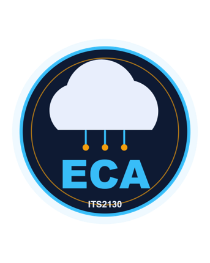

  

This GitHub organization serves as the official **code base** and **project template hub** for students who enrolled in the Enterprise Cloud Architecture module, which is part of the [HDSE](https://www.ijse.lk) program at the [Institute of Software Engineering](https://www.ijse.lk).

You are welcome to explore, clone, and follow the repositories as needed.

Join the Slack workspace mentioned during your lectures to take part in discussions and Q&A. 
If you run into any issues, don't hesitate to reach out via slack or [email](mailto:shamodha@ijse.lk).

Let's build cloud-native systems together! ☁️🚀
Cheers!

Your Lecturer - [Shamodha Sahan](https://shamodha.com)
